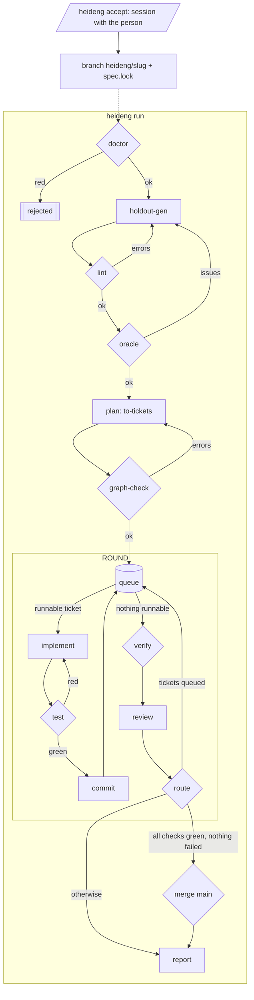

# Heideng v3 - Specification

Heideng (黑灯工厂, "lights-out factory") is a CLI that develops software from a spec with no people during the run. A person approves the spec before the run and reads the report after. In between, a fixed pipeline writes code ticket by ticket, verifies it against holdout checks the coding agents cannot see, and merges it into `main` only if verification passes.

- Input: an approved spec. Output: code merged into `main` and a report.
- A run works one spec on one project (a git repo). A project has at most one active run.
- Agents run on Claude Code under its OS sandbox. Product scripts run under [`srt`](https://github.com/anthropics/sandbox-runtime).

## References

- Level 5 "dark factory" from Dan Shapiro's [The Five Levels](https://www.danshapiro.com/blog/2026/01/the-five-levels-from-spicy-autocomplete-to-the-software-factory/); holdout scenarios from StrongDM's [Software Factory](https://factory.strongdm.ai).
- Skills: [mattpocock/skills](https://github.com/mattpocock/skills) (`to-tickets`, `tdd`, `diagnosing-bugs`, `code-review`), [DietrichGebert/ponytail](https://github.com/DietrichGebert/ponytail) (`ponytail`, `ponytail-review`).

## Principles

1. **The engine decides the path, the agent does the work.** Routing is deterministic code over exit codes, counters and budgets. Inside a node the agent works with its own tool loop and returns structured output.
2. **Every loop has two stops.** A success check other than the worker, and a budget stop: `patience` passes without progress, `max_passes`, or the run's `usd` and `wall_clock`.
3. **The worker never reads its verifier.** Holdout checks live outside the repo, in a zone every build-side sandbox denies. On a failed check the worker receives the check's Intent and output, never the check itself.
4. **Exit codes decide "done".** Build, test and checks are scripts; exit 0 is green, anything else or a timeout is red. LLM judges assess only holdout quality and code review, on a model different from the worker's.
5. **One ticket at a time.** Tickets run in sequence on one working clone; a red test has one candidate cause.
6. **The node is the unit of durability.** The engine saves state after every node; a crash loses only the node in progress.

## Glossary

| Term | Meaning |
|---|---|
| Spec | Free-form document describing the change; after accept in `.heideng/specs/<slug>/spec.md` |
| Slug | Spec file name, lowercase, `[a-z0-9-]` |
| AC | Acceptance criterion with a stable id (`AC-1`) in `acceptance.yaml`, `auto` (a check settles it) or `manual` (the person judges it after the merge) |
| Contract | `.heideng/contract.yaml`: host prerequisites and how checks drive and observe the product |
| Decisions | `.heideng/specs/<slug>/decisions.yaml`: product choices fixed at accept, plus the agents' choices during the run |
| Check | Holdout unit: `check.md` (Intent, Assertions) plus an executable `run`, optional `overlay/` |
| Overlay | Test files a check adds to a disposable checkout before the build |
| Smoke | `build`, `test`, then `start` and `ready` when present |
| Ticket | Unit of work, see [Tickets](#tickets) |
| Visit | One pass of a ticket through implement and test |
| Round | Tickets in sequence until none is runnable, then verify and review |
| Zone | `state`, `work` or `holdout`: `~/.heideng/<zone>/<project>/` |
| Escalation | Problem the person must close before the run continues, id `E-<n>` |

## Limits

- One active run per project, one ticket at a time, one person on one machine (macOS, Linux).
- Checks of earlier specs do not run again; the project's own `test` suite carries regression.
- Tests and checks run inside `srt`. Behaviour that only runs outside the sandbox (UI automation, simulators, devices) is covered by `manual` ACs.
- Check output can expose expected values; code fitted to that output passes.
- Judges and worker share one provider.

## Pipeline



| Node | Type | What |
|---|---|---|
| accept | LLM, interactive | completes the spec with the person; writes spec, ACs, contract, decisions |
| doctor | tool | prerequisites, isolation probe |
| holdout-gen | LLM | checks from spec, ACs, contract and decisions, without the repo |
| lint | tool | every `auto` AC covered, `run` executable, sections present |
| oracle | LLM judge | non-trivial assertions per `auto` AC |
| plan | LLM | `to-tickets` on a clone of the branch |
| graph-check | tool | acyclic, dependencies exist, every AC covered |
| implement | LLM | one ticket in the work clone |
| test | tool | smoke in the work clone |
| verify | tool | holdout checks on a disposable checkout |
| review | LLM judge | `code-review` and `ponytail-review` on the round diff |
| route | tool | new round, merge, or report |
| merge main | tool | merge, smoke, fast-forward of `main` |
| report | tool | `report.md` |

## Project interface

### Scripts

| Script | Required | Exit 0 means |
|---|---|---|
| `.heideng/build` | always | the product is built |
| `.heideng/test` | always | the project's tests pass |
| `.heideng/start` | long-running products | runs in the foreground until killed; starts the product's dependencies itself |
| `.heideng/ready` | with `start` | the product accepts requests |

- Run through the shebang, from the checkout root, under `srt` with the rules of the zone.
- Environment: `HEIDENG_PORT` (a free port), `HEIDENG_DATA` (an empty directory per execution), `HEIDENG_APP_DIR` (the checkout, for check runs), `HOME` set to the zone's home.
- Timeout `limits.script_timeout`, red with "timeout". `start` runs in its own process group; the engine polls `ready` up to `limits.ready_timeout` and kills the group at the end of the step.

### Contract

`.heideng/contract.yaml`, one per project, edited by accept:
- `requires`: one command per host prerequisite, exit 0 when it holds (`xcodebuild -version`).
- `drive`: how checks reach the product (routes, commands, public modules, UI labels), the overlay directories checks may write, the time control when behaviour depends on time. Overlay directories exist in the repo, empty, wired into the build; `test` does not run them.
- `observe`: what checks read (output, files under `HEIDENG_DATA`, DB rows).

## Accept: `heideng accept <spec>`

1. The engine prepares `state/accept/<slug>/` with the spec, the contract and the accept prompt, and starts an interactive `claude` session there.
2. The agent, with the person:
   - checks the spec against the contract and proposes what is missing;
   - asks for each product choice the spec leaves open (language, dependencies, formats, error precedence);
   - extracts the ACs, each `auto` or `manual`;
   - writes `spec.md`, `acceptance.yaml`, `contract.yaml`, `decisions.yaml`, and tells the person to `/exit` when satisfied.
3. The engine checks the formats and runs every `requires` command; errors resume the same session with the errors as first message.
4. On `y` the engine creates `heideng/<slug>` from `main` when missing and commits the four files plus `spec.lock` (hashes of the four files).

Accept on a spec with a stopped run ends that run. The next `heideng run` starts on top of the branch and plans only what the code there does not do yet. Every change to spec, ACs, contract or decisions goes through accept.

## Holdout

```text
holdout/<slug>/
  manifest.json      spec.lock hash, file hashes, oracle verdict
  <check-id>/
    check.md         frontmatter acs; sections Intent, Assertions
    run              executable, exit 0 = pass
    overlay/         optional, mirrors repo paths under <overlay dir>/<slug>/<check-id>/
```

- holdout-gen and oracle run with cwd `holdout/<slug>/` and read only a copy of the four accepted files. Neither has access to the repo.
- Intent describes the behaviour in user terms without expected values; it is the only text a worker may receive.
- Lint: every `auto` AC covered, every cited AC exists, `run` has a shebang and is executable, sections present, overlays under their path.
- Oracle: output `{ ok, issues[] }`. An issue is an `auto` AC with no assertion a wrong product would fail, a trivial assertion (exit code only, non-empty output), a nondeterministic step, or an Intent that states an expected value.
- With the manifest valid for the current `spec.lock`, the engine skips generation. During a run checks are immutable; verify rechecks the hashes.

## Plan

- `/to-tickets` on a fresh clone of `heideng/<slug>` with the local-files tracker: one file per ticket in `.scratch/<slug>/issues/` with a `## Blocked by` section and a `**Covers:** AC-1, AC-2` line.
- Without `.heideng/build` and `.heideng/test` on the branch, `T-01` is the bootstrap: stack, scripts, overlay directories wired into the build, a skeleton and one test. Every other ticket depends on it.
- The engine converts the files into tickets and discards every other change in the clone.
- Graph-check: acyclic, dependencies exist, every AC covered. Errors resume the plan session.
- Order: topological, then by id.

## Tickets

| Field | Meaning |
|---|---|
| `id` | `T-<n>` from plan, `F-<n>` from verify, `R-<n>` from review |
| `title`, `body` | what to do; for `F` the check's Intent and output, plus the previous summary when the same check failed before |
| `covers`, `deps` | AC ids; ticket ids that must be `done` first |
| `status` | `queued`, `implementing`, `done`, `failed`, `escalated` |
| `visit`, `base`, `commit` | visit counter, base sha, commit sha |

A ticket is runnable when `queued` with every dep `done`. Dependents of a `failed` or `escalated` ticket wait.

## Round

### Implement

- A new `claude -p` session per visit, cwd the work clone `work/runs/<run>/work`, worker sandbox.
- Prompt: ticket, spec, `acceptance.yaml`, `contract.yaml`, `decisions.yaml`, script rules; on `visit > 1` the compressed output of the previous red test.
- Skills: `tdd` drives the loop, `ponytail` shapes the code of each green step, `diagnosing-bugs` on `visit > 1`.
- Where ticket and documents do not decide, the agent takes the conservative choice (no new dependency, no public interface change, smallest diff) and records it.
- Output: `{ status: done|blocked, summary, decisions[] }`. The engine appends `decisions[]` to `decisions.yaml` in the ticket's commit. `blocked` marks the ticket `escalated`.

### Test

- Smoke in the work clone.
- Green: the engine commits `<id>: <title>` and pushes to `heideng/<slug>`.
- Red: `visit` increments, implement runs again.
- `patience` visits without progress (same first error line) or `max_passes` visits: ticket `failed`, reset to `base`, escalation, next runnable ticket.

### Verify

Runs when nothing is runnable.

1. Holdout hashes match the manifest.
2. Export of `heideng/<slug>` without git metadata in `holdout/runs/<run>/r<n>/checkout/`, with every overlay copied in.
3. `build`. Red: one ticket `F-<n>` "build red with holdout overlays" carrying only the output lines that cite files outside the overlay directories.
4. Each check: `start` and `ready` when present, the check run, stop. Exit code is the verdict.
5. A failed check whose ACs are all covered by `done` tickets becomes `F-<n>` with Intent and the last `limits.output_lines` lines, holdout paths replaced by `<holdout>`. Otherwise the report lists it as pending.

The engine deletes the checkout after the step.

### Review

- One session per round on a clone of the branch, model `nodes.review`; changes discarded.
- `/code-review` and `ponytail-review` on `<round base>..heideng/<slug>` with spec and ACs. Output `{ notes: [{ axis: spec|standards|lean, severity: blocking|minor, msg, files[] }] }`.
- Round 1: every `blocking` note becomes `R-<n>`. Later rounds: only `blocking` notes on the `spec` axis. The rest goes to the report.

### Route

- Tickets queued: new round.
- Every check green, no ticket `failed` or `escalated`: merge main.
- Otherwise: report.

## Merge main

1. In `work/runs/<run>/merge/`, a clone of `main`: `git merge --no-ff heideng/<slug>`.
2. Smoke on the result.
3. Fast-forward `main` in the project repo with a compare-and-swap `git update-ref`; when `main` is checked out, `git merge --ff-only` on a clean working tree.

A conflict, a red smoke, a dirty tree or a moved `main` opens an escalation of kind `merge`.

## Isolation

| Zone | Contents | Written by | Denied to |
|---|---|---|---|
| `state` | run state, logs, accept staging | the engine | every sandbox |
| `work` | work, plan, review and merge clones, their `HOME` | implement, plan, review, build-side scripts | holdout-gen, oracle, check runs |
| `holdout` | checks, holdout inputs, verify checkouts | holdout-gen, oracle, verify | implement, plan, review, build-side scripts |

- Every LLM node runs under the Claude Code sandbox; every product script and check run under `srt` with the same rules as its zone.
- The person's real home is denied except the `sandbox.read` paths. Network is limited to `sandbox.allow` for build and test, `localhost` for `start`, `ready` and check runs.
- Accept runs outside the sandbox, with the person, who approves every Bash command and every write outside the staging folder.
- Doctor runs at accept and at every run start: each `requires` command on the host and in the sandbox; a canary file in `holdout` unreadable from the worker sandbox and the repo unreadable from the holdout sandbox; `nodes.review` differs from `nodes.implement` and `nodes.oracle` from `nodes.holdout-gen`. Red rejects the command with the failing probe.

## Stops, budgets and escalations

| Loop | Pass | Success | Progress |
|---|---|---|---|
| holdout | gen, lint, oracle | lint ok, oracle `ok` | the set of errors and issues changes |
| plan | plan, graph-check | graph-check ok | the set of errors changes |
| visits | implement, test | test green | the first error line changes |
| rounds | one round | every check green | the set of failed checks changes |

- `patience` and `max_passes` apply to every loop; exhausting them opens an escalation.
- `usd` and `wall_clock` bound the run; exhausting either opens an escalation of kind `budget` and stops the run.
- Each LLM call has `max_usd`, `max_turns`, `timeout`; exhausting one counts as a pass without progress. API errors retry `limits.llm_retries` times, then the run fails.
- The engine writes each escalation to `state/runs/<run>/escalations/E-<n>.md`: what, why, evidence, how to close.
- Closing: the person changes spec, ACs, contract or decisions through `heideng accept`, or grants budget with `heideng resume`. `resume` requeues `failed` and `escalated` tickets with `visit` 0.

| Outcome | Exit |
|---|---|
| merged | 0 |
| stopped: escalation | 1 |
| stopped: budget | 2 |
| stopped: interrupted (Ctrl-C, SIGTERM) | 3 |
| failed: engine error, LLM retries exhausted | 4 |
| rejected: invalid lock, active run, red doctor | 5 |

## State and resume

```text
state/
  run.lock               pid and run id of the active run
  accept/<slug>/         staging of the accept session
  runs/<run>/
    run.json             cursor, plan, tickets; written atomically after every node
    events.jsonl         one JSON object per event
    report.md
    tickets/<id>.md
    escalations/<id>.md
    nodes/<exec>/        prompt.md, stream.jsonl, response.json, test.log
```

- `heideng resume` restarts the node in progress, resets an `implementing` ticket to its base, and grants each exhausted budget a new allowance (`--add-usd`, `--add-time`, `--add-passes` set it explicitly).
- A `run.lock` whose pid is not running means the engine crashed; `resume` takes the lock.
- Events: `run.start`, `run.end`, `node.start`, `node.end`, `ticket.status`, `commit`, `verdict`, `decision`, `escalation`, each with timestamp, exec and cost.

## Report

```markdown
# <spec> - run <id>
Outcome: merged <sha> | stopped: <reason> | failed
Round 3 - $27.80 / 50 - 5h12 / 6h - $2.10 per verified AC

## To do for you
- [ ] E-1: <reason>
- [ ] manual AC-7: <text>
- [ ] decision (T-03): <text>

## Checks
## Tickets
## Review notes
## Costs
```

The metric is cost per verified AC: total cost divided by the `auto` ACs whose checks pass.

## CLI

| Command | What it does |
|---|---|
| `heideng init` | writes `heideng.yaml` and an empty contract; runs doctor |
| `heideng doctor` | prerequisites and isolation probe |
| `heideng accept <spec>` | interactive session, checks, branch and lock |
| `heideng run <spec>` | runs the pipeline |
| `heideng resume [--add-usd n] [--add-time d] [--add-passes n]` | continues the stopped run |
| `heideng status` | active run, current node, open escalations |

During a run stderr prints one line per event: `<time> <exec> <type> <outcome> <cost>`.

## Config

`heideng.yaml` in the repo root:

```yaml
sandbox:
  allow:            # network domains for build and test
    - registry.npmjs.org
  read:             # toolchain paths under the real home, read-only
    - ~/.nvm
  write:            # toolchain caches, under the zone HOME
    - ~/.npm
budgets:
  usd: 50
  wall_clock: 6h
  patience: 2
  max_passes: 10
limits:
  script_timeout: 20m
  ready_timeout: 60s
  output_lines: 40
  llm_retries: 2
nodes:
  defaults:
    max_usd: 5
    max_turns: 200
    timeout: 60m
  accept: opus
  holdout-gen: opus
  oracle: sonnet
  plan: opus
  implement: sonnet
  review: opus
```

## File formats

YAML: block style only, free text as `|` block scalars, `true`/`false` the only booleans. The engine validates every file against its schema and returns errors to the session that wrote it.

`acceptance.yaml`:

```yaml
acs:
  - id: AC-1
    kind: auto
    text: |
      <text>
```

`contract.yaml`:

```yaml
requires:
  - "<command>"
drive:
  overlay:
    - <directory>
  time: |
    <text>
  entries:
    - name: <name>
      text: |
        <text>
observe:
  entries:
    - name: <name>
      text: |
        <text>
```

`check.md`:

```markdown
---
acs:
  - AC-1
---

## Intent
<text>

## Assertions
- <text>
```

`decisions.yaml`:

```yaml
decisions:
  - source: accept | <ticket id>
    text: |
      <text>
```

`spec.lock`: `{ "files": { "<name>": "sha256:<hex>" } }` for the four accepted files.

## Runtime binding

- LLM nodes: `claude -p` with `--settings` generated per execution, `--setting-sources ""`, `--permission-mode dontAsk`, `--plugin-dir` with the node's skills, `--model`, `--json-schema` for the output, `--max-budget-usd`, `--max-turns`, `CLAUDE_CONFIG_DIR=state/runs/<run>/claude/`. Credentials: `CLAUDE_CODE_OAUTH_TOKEN` or `ANTHROPIC_API_KEY` from the engine's environment.
- Worker sandbox settings: `sandbox.enabled`, `failIfUnavailable`, `allowUnsandboxedCommands: false`; `denyRead` the real home and the denied zones; `allowRead` cwd, zone home, `sandbox.read`; `allowWrite` cwd, zone home, `sandbox.write`; `allowedDomains` from `sandbox.allow`.
- Product scripts: `srt --settings <file>` with the same filesystem and network rules.
- Skills are vendored at pinned shas in `skills/` with a manifest of file hashes, checked at run start.

| Node | Skills |
|---|---|
| plan | `to-tickets` |
| implement | `tdd`, `ponytail`, `diagnosing-bugs` |
| review | `code-review`, `ponytail-review` |

- Implement precedence: `tdd` sets test order and count (red before green, tests at the seams); `ponytail` sets the code of each green step and adds no test.
- Output compression, no LLM: identical consecutive lines collapse with a count; keep lines matching `(?i)error|fail|panic|exception` with 3 lines after, then the last `limits.output_lines` lines. The first error line is the first match, else the last non-empty line.
- Testability: `HEIDENG_CLAUDE_BIN` and `HEIDENG_SRT_BIN` replace `claude` and `srt` with stubs; tests drive the binary on fixture repos with real git.
