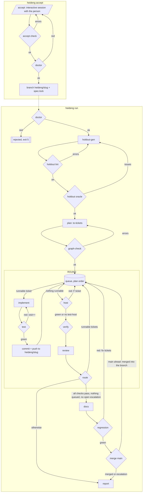

# Heideng v2 - Specification

Heideng (黑灯工厂, heideng gongchang, "lights-out factory") is a CLI that develops software from a spec with no people during the run. A person approves the spec before the run and reads the report after. In between, a fixed pipeline writes code ticket by ticket, verifies it against holdout checks the coding agents cannot see, and merges it into `main` only if verification passes.

- Input: an approved spec. Output: code merged into `main` and a report.
- A run works one spec on one project (a git repo). A project has at most one [active run](#glossary).
- The product builds, runs and passes verification on the person's machine, with the person's toolchain. Every kind of product goes through the same pipeline; [product profiles](#product-profiles) describe how each kind plugs in.
- Agents run on Claude Code. Isolation is the OS sandbox of Claude Code for agents and of [`srt`](https://github.com/anthropics/sandbox-runtime) for the product's scripts.

The spec has two parts. [Part I](#part-i---core) defines the factory: principles, pipeline, project interface, isolation model, stops, state and CLI. [Part II](#part-ii---runtime-binding) maps it onto the current tools: Claude Code flags and settings, `srt` settings, product profiles, vendored skills and doctor probes. Part I names the tools it binds to (Claude Code, `srt`) where the design depends on them; their flags, settings and file formats are in Part II. Part II changes with the tools; Part I changes with the design.

## References

- Level 5 "dark factory" from Dan Shapiro's [The Five Levels](https://www.danshapiro.com/blog/2026/01/the-five-levels-from-spicy-autocomplete-to-the-software-factory/); holdout scenarios invisible to the agents from StrongDM's [Software Factory](https://factory.strongdm.ai).
- Skills the nodes run, by source:
  - [mattpocock/skills](https://github.com/mattpocock/skills): `to-tickets`, `tdd`, `diagnosing-bugs`, `code-review`, and the vocabulary skills `codebase-design` (module, interface, seam) and `domain-modeling` (glossary, ADRs);
  - [obra/superpowers](https://github.com/obra/superpowers): `verification-before-completion`;
  - [DietrichGebert/ponytail](https://github.com/DietrichGebert/ponytail): `ponytail` and `ponytail-review`.
- Claude Code [sandboxing](https://code.claude.com/docs/en/sandboxing) and [permissions](https://code.claude.com/docs/en/permissions).

## Part I - Core

### Principles

1. **The engine decides the path, the agent does the work.** Routing is deterministic code over outcomes, counters and budgets. Inside a node the agent works with its own tool loop and returns structured output.
2. **Every loop has two stops.** Success comes from a check other than the worker. The budget stop closes the loop with a written reason: `patience` passes without progress, the `max_passes` cap, or the run's `usd` and `wall_clock`.
3. **The worker never reads or changes its verifier.** Holdout checks live in the `holdout` zone, outside the repo, which every sandbox denies to the build scope: the coding agents and every script of the build scope. On a failed check the worker receives the check's Intent and the output of its `run`, never `check.md` or the code of `run`. The output can expose expected values; see [Non-goals and limits](#non-goals-and-limits).
4. **Exit codes decide "done".** Build, test and holdout checks are scripts; their exit code is the verdict, [green or red](#glossary). LLM judges assess only what a script cannot assess (holdout quality, code review), on a model different from the worker's.
5. **Everything heideng runs on the product is a script.** Build, test, start, ready, services and every holdout check are executables with a shebang, run on the host from a known directory with a known environment.
6. **One thing at a time.** Tickets run in sequence on one working clone, each on top of the previous ticket's commit. The only code change since the last green commit is the ticket in progress.
7. **The node boundary is the unit of durability.** After every node the engine saves state; a crash loses only the node in progress, which restarts from scratch on resume. A node whose effect is already visible in git (a pushed commit, a moved `main`) counts as done on resume.
8. **Agents read only what their node declares.** Each node has a list of readable paths; the sandbox enforces it and the audit checks it. The person's home and the other zones stay closed.
9. **The metric is cost per verified AC.** Total cost divided by the ACs whose holdout checks pass.

### Glossary

| Term | Meaning |
|---|---|
| Spec | Free-form document describing the change. After `accept` it is in `.heideng/specs/<slug>/spec.md` |
| Slug | Id of a spec: the spec file name, lowercase, `[a-z0-9-]`. `inputs`, `retired`, `runs`, `home` and `doctor` are reserved |
| AC | Acceptance criterion with a stable id (`AC-1`) in `acceptance.yaml`, marked `auto` or `manual`. Outside its spec an AC is cited as `<slug>/AC-1` |
| Active spec | A spec merged into `main` whose checks are not retired. Its ACs are the active ACs; its checks run in regression |
| Contract | `.heideng/contract.yaml`, one per project, cumulative: host prerequisites, product scripts, services, how checks drive and observe the product |
| Requires | An entry of the contract's `requires` list: a command that exits 0 when a host prerequisite holds |
| Decisions | `.heideng/specs/<slug>/decisions.yaml` on the branch: product choices fixed at accept, then the agents' decisions and resolve notes of the run |
| Check | Holdout unit: `check.md` (frontmatter `acs` and `contract`, sections Intent and Assertions) plus an executable `run`, optional `overlay/` |
| Check run | The execution of a check's `run`; `check-run` in `sandbox.relaxed` |
| Overlay | Files a check adds to a disposable checkout before the build (test files compiled against the product) |
| Green, red | Exit 0 of a script, any other exit or a timeout |
| Flaky | Verdict of a check that is red, then green on the same code; it counts as fail |
| Smoke | The product scripts of a step, in the order of [Scripts by step](#scripts-by-step), each when the product has it |
| Profile | Preset of contract and config for a kind of product, see [Product profiles](#product-profiles) |
| Ticket | Unit of work, see [Tickets](#tickets) |
| Plan | Ticket list validated by graph-check for one `spec.lock` version |
| Visit | One pass of a ticket through implement and test |
| Round | Tickets in sequence until none is runnable, then host, verify and review |
| `base_round` | Head of `heideng/<slug>` when the round starts |
| Work clone | The run's single clone of `heideng/<slug>`, where every ticket is implemented |
| Seam | Public boundary where a test observes behavior, as defined by the `tdd` skill |
| Scope | Isolation unit of a sandboxed execution, see [Scopes](#scopes) |
| Zone | `state`, `work` or `holdout`: a directory under `~/.heideng/` with one `<project>/` per project. Paths in this spec start with their zone: `state/runs/<run>/run.json` is `~/.heideng/state/<project>/runs/<run>/run.json` |
| Project, run | `<project>`: base name of the repo root and a short hash of its path. `<run>`: `<slug>-<n>`, `n` counting the runs of the spec |
| Exec | Deterministic key of a node execution, see [State and resume](#state-and-resume) |
| Relaxed profile | Product sandbox with network and writes open and the zone denials kept, see [Sandbox model](#sandbox-model) |
| Host directory | A per-user directory of the host outside `HOME` and `TMPDIR` that toolchains write to, opened by `$NAME` in `sandbox.write` |
| Declared reads | The paths a node may read besides its cwd and scope home, see [Declared reads and audit](#declared-reads-and-audit) |
| Active run | A run with no `run.end`, or ended `stopped` with a reason other than `spec-changed` and `holdout-changed`. It holds `state/run.lock` |
| Patience | Consecutive passes without progress a loop tolerates |
| Escalation | Problem the person must close before the run continues; id `E-<n>`, counted per run |

### Non-goals and limits

Non-goals:
- Concurrent work: one active run per project, one ticket at a time.
- Remote or CI execution: every node runs on the person's machine with the person's toolchain.
- Other runtimes: agents run on Claude Code, product scripts on `srt`; the supported OSes are the ones both sandbox (macOS, Linux).
- Several people: state, budgets and escalations belong to one person on one machine.
- A person during the run: the person takes part at accept and resolve, and reads the report.
- `manual` ACs as merge gates: the person judges them on `main` after the merge.

| Risk | Impact | Mitigation | Residual |
|---|---|---|---|
| Check output exposes expected values | the worker can fit the code to the output | the worker receives Intent and output, never `check.md` or `run`; the check runs independently of the worker | code that fits the output and passes the check passes |
| Overlay files are readable by the product build | product code can quote overlay tests in its output | build-red output keeps only lines that cite product files ([Verify](#verify-tool)) | output of a check run can quote overlay content |
| Relaxed profile | relaxed scripts read the real home and write outside the zones | the zone denials stay; the report lists each relaxed script under "Isolation weakened" | credentials in the real home are reachable by agent-written code |
| Host directories in `sandbox.write` | build and verify scope share them | the report lists them under "Isolation weakened" | a build script can leave files a check run reads |
| App secrets reach scripts the worker writes | a script can send them out | `state/env` holds only test secrets; values reach only `services`, `start`, `ready` and check runs, which reach only `localhost`; files the engine writes carry `***` | a script under the relaxed profile reaches every domain |
| Accept and resolve run outside the sandbox | an evidence file can carry a prompt injection | the person is in the session and approves every Bash command and every write outside the staging folder | an approved action runs with the person's permissions |
| Regression time grows with the active specs | `wall_clock` spent on old checks | reds are rerun on `main` only when red; superseded checks retire at merge | linear growth with the project's history |
| Judges and worker share one provider | correlated blind spots | review and oracle use a model different from the worker's | same provider |
| The leak audit sees only agent tool calls | reads by scripts are not audited | the sandbox denials are the control; the audit is a tripwire | none beyond the sandbox's own |

### Alternatives considered

| Decision | Chosen | Rejected | Reason |
|---|---|---|---|
| Ticket execution | sequence on one clone | parallel worktrees | a red test has one candidate cause; tickets never merge with each other |
| Isolation | OS sandbox of Claude Code and `srt` | containers, VMs | the product builds with the person's native toolchain (Xcode, simulators); no image to maintain |
| Holdout location | local zone denied by the sandbox | remote verifier service | no infrastructure; the same machine builds and verifies |
| Execution host | the person's machine | CI | the product needs the person's toolchain and devices |
| Delivery | fast-forward of the local `main` | pull request | no person during the run; the report is the review surface |
| Contract | one cumulative contract per project | one contract per spec | checks of every active spec drive the same product surface |
| Verdicts | exit codes, LLM only for holdout quality and review | LLM verdict per AC | exit codes are deterministic and cheap to rerun |
| Services lifetime | start and stop per check | one lifetime per step | each check starts from empty data |

### Pipeline



| Node | Type | What |
|---|---|---|
| accept | LLM, interactive | completes the spec with the person; writes spec, ACs, contract, decisions |
| accept check | tool | format of ACs and contract, Requires commands run on the host |
| doctor | tool | Requires commands, isolation probe, skills of each node; see [Doctor](#doctor) |
| holdout-gen | LLM | checks from spec, ACs and contract, without the repo |
| holdout lint | tool | traceability, executables, sections |
| holdout oracle | LLM judge | coverage and non-trivial assertions |
| plan | LLM | `to-tickets` on a clone of the branch |
| graph-check | tool | acyclic, dependencies exist, every AC covered |
| implement | LLM | one ticket in the work clone, sandboxed |
| test | tool | smoke in the work clone, under `srt` |
| host | tool | smoke with `test-host` in the work clone, once nothing is runnable |
| verify | tool | holdout checks on a disposable checkout |
| review | LLM judge | `code-review` and `ponytail-review` on the round diff |
| route | tool | new round, docs and regression, or stop |
| docs | LLM | documentation of the change, committed on the branch |
| regression | tool | checks of active specs on the branch |
| merge main | tool | `main` merged into the branch when ahead, else `git merge --no-ff heideng/<slug>`, smoke, fast-forward of `main` |
| report | tool | `report.md` |

Every budget stop leads to report. An escalation on a ticket leaves the round running: the next runnable ticket starts, and the round verifies what is done once nothing is runnable.

### Project interface

#### Scripts

The product exposes itself to heideng through scripts in the repo.

| Script | Required when | Exit 0 means |
|---|---|---|
| `.heideng/build` | always | the product is built |
| `.heideng/test` | always | the project's tests that run in the sandbox pass |
| `.heideng/test-host` | tests the sandbox cannot run | the project's other tests pass |
| `.heideng/services` | products with runtime dependencies (database, queue) | runs the dependencies in the foreground until killed |
| `.heideng/services-ready` | with `services` | the dependencies accept connections |
| `.heideng/start` | products with a long-running process | runs in the foreground until killed |
| `.heideng/ready` | with `start` | the started product accepts requests |

Execution rules, the same in every step:
- Run through the shebang, from the root of the checkout, under `srt` with the [product sandbox](#sandbox-model). `test-host` and the scripts listed in `sandbox.relaxed` run under the [relaxed profile](#sandbox-model).
- Environment:
  - `HEIDENG_PORTS`: space-separated free ports the engine picks, as many as the contract's Run section declares (default 1); `HEIDENG_PORT` is the first;
  - `HEIDENG_DATA`: an empty directory per execution;
  - `HEIDENG_EVIDENCE`: directory for files the run keeps;
  - `HEIDENG_APP_DIR`: the checkout under test, for check runs only;
  - `HOME` set to the [scope home](#scopes);
  - [app secrets](#credentials-and-secrets) by script.
- Timeout `limits.script_timeout` per script; a timeout is red with the note "timeout".
- `services` and `start` run each in their own process group. The engine polls their ready script up to `limits.ready_timeout`, then kills the groups at the end of the step.

#### Scripts by step

| Step | Scripts |
|---|---|
| test | `build`, `services`, `services-ready`, `test`, `start`, `ready` |
| host, merge main | `build`, `services`, `services-ready`, `test`, `test-host`, `start`, `ready` |
| docs | `build`, `services`, `services-ready`, `test`, `start`, `ready` |
| verify, regression | `build` once, then per check `services`, `services-ready`, `start`, `ready`, check run |

- Each script runs when the product has it. `services` starts before `test`, `test-host`, `start` and every check run, and stops at the end of the step.
- `test-host` holds the tests the sandbox cannot run (a test runner service, launching the app, a pseudo-terminal); every test that runs in the sandbox stays in `test`.
- The worker cannot run `test-host`. When the sandbox blocks a test, the worker moves it to `test-host` instead of returning `blocked`. The resolve session proposes the same split for an escalation caused by such a restriction.

#### Contract

`.heideng/contract.yaml` is in the repo and is cumulative. Each spec changes only the parts it touches on its branch; the delta enters `main` with the run's merge, and `spec.lock` records its hash. It has five keys, in the format of [File formats](#file-formats):

- **Requires** (`requires`). One command per host prerequisite that exits 0 when the prerequisite holds: `xcodebuild -version`, `node -e "process.exit(+process.versions.node.split('.')[0] < 22)"`. The engine runs them on the host and inside the sandboxes.
- **Run** (`run`). The profile, which of `start`, `ready`, `services`, `services-ready` and `test-host` exist, the number of ports, what the product reads from the environment, and the cache directories inside the checkout that a reset keeps (`node_modules`, `.build`).
- **Services** (`services`). Each runtime dependency `services` starts, with the port and data directory it uses.
- **Drive** (`drive`). What checks use to reach the product: routes, commands and exit codes, public modules and types, UI labels and accessibility identifiers, the overlay directories checks may write (`Tests/HoldoutTests/`). Overlay directories exist in the repo, empty, already wired into the build with their subdirectories (a test target, a recursive test glob), and `test` does not run them. If a behavior depends on time, Drive declares the time control.
- **Observe** (`observe`). Evidence a check reads: output, files under `HEIDENG_DATA`, DB rows.

#### Product profiles

A profile is the preset accept proposes for the contract and `heideng.yaml`: how check runs reach the product, what overlays contain, which Run scripts exist and which sandbox exceptions the kind of product needs. The engine reads only the contract and the config; adding a profile changes neither the engine nor the config schema. The profiles are listed in [Part II](#product-profile-presets).

### Accept: `heideng accept <spec>`

One of the two interactive sessions with the person; the other is [resolve](#resolve-heideng-resolve-id).

1. The engine prepares `state/accept/<slug>/` with a copy of the spec, `.heideng/contract.yaml`, the `acceptance.yaml` of active specs, the profiles and the accept prompt, and starts an interactive `claude` session there. The person and the agent talk directly.
2. The agent:
   - picks the profile with the person and checks the spec against the contract keys, proposing what is missing (Requires, scripts, Services, Drive, Observe);
   - lists the product choices the spec leaves open (language and version, dependencies, normalization of input, output formats, ordering tie-breaks, error precedence) and asks the person for each;
   - extracts the ACs with stable ids, each `auto` (a check can settle it) or `manual` (the person judges it after the run);
   - lists the ACs of active specs this spec modifies or removes, as `<slug>/AC-n`;
   - writes `spec.md`, `acceptance.yaml`, `contract.yaml` and `decisions.yaml` in the directory, in the [file formats](#file-formats);
   - tells the person to type `/exit` when satisfied.
3. When the session ends the engine runs the accept check:
   - ACs: unique ids, `auto` or `manual` on each, every superseded `<slug>/AC-n` exists among the active ACs;
   - contract: the five keys, at least one `requires` entry, `drive.overlay` lists the overlay directories;
   - every `requires` command exits 0 on the host.
4. With the accept check passed the engine runs [doctor](#doctor).
5. Errors of either: the engine prints them and `heideng accept <spec>` resumes the same session with the errors as the first message.
6. Ok: the engine asks `y/n`. On `n` nothing changes and the staging stays for the next `accept`. On `y` it creates `heideng/<slug>` from `main` when it does not exist, and commits on it `spec.md`, `acceptance.yaml`, `decisions.yaml` and `spec.lock` under `.heideng/specs/<slug>/`, and the contract at `.heideng/contract.yaml`. `spec.lock` holds the version, the hashes of the committed files and the superseded ACs.

A lock is valid when its hashes match the committed files. `heideng run` rejects a spec without a valid lock, with `heideng/<slug>` checked out in a worktree of the project repo, or already merged on this lock. `heideng accept` rejects a slug with `.heideng/specs/<slug>/` on `main`: a change to a merged spec is a new spec that supersedes its ACs. `heideng accept` on a spec whose run is in progress is rejected; on a spec whose run is stopped, the new lock ends that run as `stopped`, reason `spec-changed`, and the next `heideng run` starts a new run on top of the branch.

### Holdout

The layout of the `holdout` zone for checks:

```text
holdout/<slug>/
  manifest.json        spec.lock hash, file hashes, oracle verdict
  <check-id>/
    check.md           frontmatter acs, contract; Intent, Assertions
    run                executable, exit 0 = pass
    overlay/           optional, mirrors paths of the repo
holdout/inputs/<slug>/ spec.md, acceptance.yaml, contract.yaml, decisions.yaml, holdout-notes.yaml for holdout-gen
holdout/retired/<slug>/<check-id>/   with the reason
```

- `check.md` has a YAML frontmatter and two sections. `acs` lists the ids it covers; `contract` lists the Drive and Observe entries the check uses. Intent describes the behavior in user terms and is the only text of the check a worker may receive. Assertions describes what `run` verifies, for the oracle.
- An `auto` AC has at least one check. A check covers one or more ACs of its spec.
- Overlay paths fall under `<overlay directory>/<slug>/<check-id>/`, for an overlay directory of the contract's Drive, so overlays of different checks never share a path. An overlay file that would overwrite a file of the checkout makes the check red with "overlay collision", an escalation of kind `holdout`.

#### Generation

- At the start of the node the engine copies the four accepted files from the branch into `holdout/inputs/<slug>/`, next to the `holdout-notes.yaml` of resolve when present. holdout-gen regenerates the checks the notes name.
- holdout-gen and the oracle run with cwd `holdout/<slug>/`. holdout-gen's declared reads are `holdout/inputs/<slug>/` and the checks of the other active specs. Neither has access to the repo.
- holdout-gen writes checks only for the ACs of its spec. A behavior that a superseded AC described is covered by the ACs of the new spec; the checks of the superseded AC stay with their spec until merge main retires them.
- Holdout lint (tool): every `auto` AC covered, every cited AC exists, `run` executable with a shebang, `check.md` frontmatter and sections present, every entry of its `contract` exists in the contract, overlay under `<overlay directory>/<slug>/<check-id>/`.
- Holdout oracle: coverage and non-trivial assertions, on `check.md` and `run`. Output `{ ok, issues[], fixed }`, `fixed` being the number of issues of the previous judgment now resolved. After `ok: false` the next judgment receives its issues and only the files changed since.
- Reuse: with the manifest validated for the current `spec.lock` hash and file hashes unchanged, the engine skips generation and oracle.
- Inside a run checks are immutable; verify rechecks the hashes before running them.

### Plan

- The plan node runs `/to-tickets <spec>` on a fresh clone of `heideng/<slug>`, sandboxed, with the local-files tracker: one file per ticket under `.scratch/<slug>/issues/<NN>-<title>.md` with a `## Blocked by` section. heideng's prompt adds the rules:
  - every ticket has a `**Covers:** AC-1, AC-2` line;
  - the breakdown covers only what the code on the branch does not do yet;
  - without `.heideng/build` and `.heideng/test` on the branch, `T-01` is the bootstrap: stack, the scripts of the contract's Run section, the overlay directories of the contract's Drive wired into the build, a skeleton and one test. Every other ticket depends on it.
- The engine converts the files into `T-<NN>` tickets, `deps` from "Blocked by" and `covers` from Covers, and discards every other change in the clone.
- Graph-check: acyclic, dependencies exist, every AC (`auto` and `manual`) covered by a ticket, no ticket cites a missing AC. Errors resume the plan session.
- The engine stores the plan in `run.json`. Tickets of a previous run whose work is on the branch are not planned again, by the rule above.
- Execution order: topological, then by id.

### Tickets

| Field | Meaning |
|---|---|
| `id` | `T-<NN>` from the plan; `F-<n>` from a failed check, a red build with overlays, a red host step, or a red regression; `R-<n>` from blocking review notes |
| `source` | `plan`, `verify`, `host`, `regression`, `review` |
| `title`, `body` | what to do; for `F` tickets the check id, ACs, Intent and output |
| `covers` | AC ids; for `F` tickets the ACs of their checks, none for a red host step |
| `deps` | ticket ids that must be `done` first |
| `supersedes` | the `F` ticket of the same check in the previous round, with the `summary` of its last visit, so the worker knows what was tried |
| `status` | `queued`, `implementing`, `done`, `failed`, `escalated` |
| `visit`, `base`, `commit` | visit counter, base sha, commit sha |

The body lives in `state/runs/<run>/tickets/<id>.md`, the other fields in `run.json`. A ticket is runnable when it is `queued` and all its `deps` are `done`; the dependents of a `failed` or `escalated` ticket stay `queued` and become runnable when it is `done`. A ticket returns to `queued` with its visit counter at 0 when resolve or resume closes its escalation.

### Round

#### Work clone

- `work/runs/<run>/work` is a clone of the project on `heideng/<slug>`. Its git directory lives in the `state` zone, see [Git metadata](#git-metadata). Only the engine runs git commands.
- Before each ticket the engine records the base sha. After a green test it commits the working tree as `<id>: <title>` and pushes to `heideng/<slug>` in the project repo.
- The engine resets a failed or escalated ticket to its base sha and removes the untracked files, except the cache directories of the contract's Run section.

#### Implement

- An LLM session with cwd the work clone and the [worker sandbox](#sandbox-model). Every visit is a new session.
- Prompt: ticket, spec, `acceptance.yaml`, `contract.yaml`, `decisions.yaml`, the execution rules of the scripts. With `visit > 1`, the compressed output of the previous red test.
- [Skills](#skills): `/tdd` on every visit, `diagnosing-bugs` with `visit > 1`, `verification-before-completion` before returning `done`, `ponytail` on the code of every green step. Their precedence is in [Implement precedence](#implement-precedence).
- Output: `{ status: done|blocked|dispute, summary, decisions[], skipped[] }`. The agent decides alone. Where ticket and documents do not decide, it takes the most conservative choice: no new dependency, no change to a public interface, existing behavior kept, the smallest diff. It records the choice in `decisions[]`. The engine adds them to `decisions.yaml` in the ticket's commit, emits a `decision` event for each, and lists them in the report.
- `blocked` marks the ticket `escalated` and opens an escalation of kind `ticket`.
- `dispute`, allowed only on an `F` ticket from verify or regression, states in `summary` why the check's Intent contradicts the spec, `acceptance.yaml` or `decisions.yaml`. It marks the ticket `escalated` and opens an escalation of kind `holdout`.
- The engine adds a mandatory review note when a diff touches `.heideng/*` outside the bootstrap and outside the entries the engine adds to `decisions.yaml`.

#### Test (tool)

- Smoke in the work clone, see [Scripts by step](#scripts-by-step).
- Green: commit and next runnable ticket.
- Red: the visit counter increments and implement runs again with the output [compressed](#output-compression) without an LLM.
- `patience` visits without [progress](#stops-budgets-and-escalations) or `max_passes` visits make the ticket `failed`: reset, escalation of kind `ticket`, next runnable ticket.

#### Host (tool)

- Runs when no ticket is runnable and the contract's Run section declares `test-host`; otherwise the round goes to verify.
- Smoke with `test-host` in the work clone, exec `r<n>/host`. The engine records the head of each green host step and skips the step when the head equals a recorded one.
- Green: verify.
- Red: a ticket `F-<n>` "smoke red at <script> with test-host" with the last `limits.output_lines` lines of the output, queued in the same round. A later red host step in the round returns the same ticket to `queued` with `visit` incremented and the new output; patience and `max_passes` apply as for every ticket.

#### Verify (tool)

1. Holdout hashes match the manifest; a mismatch is an engine error.
2. Disposable checkout of `heideng/<slug>` in `holdout/runs/<run>/r<n>/verify/checkout/`: an export without git metadata, with the overlays of every check of the spec copied in. The checkout holds only the overlays; `check.md` and `run` are never copied into it.
3. `build` on the checkout. Red: no check runs and verify ends with one ticket `F-<n>` "build red with holdout overlays"; review runs as usual. From the build output the engine keeps only the lines that cite a file of the checkout outside the overlay directories, so the ticket keeps product files, missing symbols and compiler messages.
4. Each check in turn: `services`, `start` and their ready scripts when present, then the check run, stop. The exit code is the verdict.
5. A red check runs once more. Red then green is `flaky`.

Verdicts become fix tickets:
- A failed check produces no ticket when one of its ACs is covered by a ticket that is not `done`; the report lists it as "pending" with that ticket.
- One `F-<n>` per failed check with check id, ACs, Intent and the last `limits.output_lines` lines of the check run's output, holdout paths replaced by `<holdout>`.
- A `flaky` check gets the same ticket with the output of both executions and the note "flaky: same code, two verdicts".
- Failed checks whose [first error line](#output-compression) is identical share one ticket.
- A check that fails in the next round again produces a new ticket with `supersedes`.

The engine deletes the checkout and its scope directory after the step. Verify reaches the work clone only through fix tickets.

#### Review

- One LLM session per round, model different from implement, on a clone of `heideng/<slug>`. The engine discards the changes it makes.
- `/code-review` on `base_round..heideng/<slug>`, with spec and `acceptance.yaml`; `ponytail-review` feeds the `lean` axis. Output `{ notes: [{ axis: spec|standards|lean, severity: blocking|minor, msg, files[] }] }`.
- Round 1: every `blocking` note becomes `R-<n>`. Later rounds: only `blocking` notes on the `spec` axis. Other notes go to the report.

#### Route

In order:
- Runnable tickets queued: new round.
- All checks pass, no ticket queued, no ticket `failed` or `escalated`, no open escalation: docs, then regression. `manual` ACs go to "To do for you" in the report and the person judges them on `main` after the merge.
- Otherwise: report, outcome per [Outcomes](#outcomes).

### Docs, regression and merge

#### Docs

Runs in the work clone each time route goes to regression.

- An LLM session with the [worker sandbox](#sandbox-model), model from `nodes.docs`. Prompt: spec, `acceptance.yaml`, `contract.yaml`, `decisions.yaml`, the diff `<merge base with main>..heideng/<slug>` and the paths of `docs.paths`.
- The agent updates the documentation under `docs.paths` for the change: what the product does now, how to run and use it, the decisions that affect a user. It creates the files that do not exist. Output `{ summary, files[] }`.
- The engine keeps only the diff under `docs.paths` and resets the rest with a note in the report. With an empty diff the node ends with the note "no documentation change".
- Smoke on the work clone. Green: commit `docs: <slug>` and push. Red, or an LLM call that exhausts its per-call limit: reset to the head before docs, and the report carries the reason under "Docs".
- A red docs node leaves the outcome of the run unchanged.

#### Regression

- Checks of active specs on the branch, exec `regression`, like verify, skipping the checks that cover a superseded AC. The checkout holds the overlays of every check that runs.
- A red check runs once on an export of `main`, exec `regression/main`. Red there too: the check is skipped and the report lists it.
- A red check whose `contract` entries the spec's contract delta changed opens an escalation of kind `holdout`. It closes with a spec closure: the spec supersedes the check's ACs, or the contract restores the entry.
- Other red checks: fix tickets and a new round.

#### Merge main

1. If `main` holds commits the branch lacks, the engine merges `main` into the branch in the work clone, pushes, and starts a new round; route then runs host, verify, review, docs and regression on the merged code. A conflict is an escalation of kind `merge`.
2. In `work/runs/<run>/merge/`, a clone of `main`: `git merge --no-ff heideng/<slug>`.
3. Smoke on the merge result.
4. Fast-forward of `main` in the project repo to the merge commit: `git merge --ff-only` when `main` is checked out, a compare-and-swap `git update-ref` otherwise. A checked-out `main` needs a working tree with no changes to tracked files. `main` checked out in a worktree other than the main one is an escalation of kind `merge`.
5. `main` moved since step 2: back to step 1, at most `limits.merge_retries` times.
6. The engine moves the checks that cover the superseded ACs to `holdout/retired/<slug>/<check-id>/` with the reason "superseded by <slug>". The active ACs those checks also covered are listed in the report as uncovered.

A red step, a dirty working tree, a failed push or fast-forward, or `merge_retries` exhausted is an escalation of kind `merge`. On resume merge main is done when the head of `heideng/<slug>` is an ancestor of `main`; the engine then runs step 6 again, which moves only the checks still in place.

### Isolation

#### Scopes

Every sandboxed execution belongs to a scope. The scope owns a `HOME` and the only writable paths besides cwd and `TMPDIR`.

| Scope | `HOME` | Executions | Lifetime |
|---|---|---|---|
| build | `work/runs/<run>/home/` | implement, plan, review, docs, the test and host steps, merge | the run |
| verify | `holdout/runs/<run>/<exec>/scope/home/` | `build`, `services`, `start`, `ready` and check runs in verify and regression | the step |
| holdout | `holdout/home/` | holdout-gen, oracle | until the checks change |

- `sandbox.write`:
  - every `~`-relative entry resolves under the scope's `HOME`;
  - an entry `$NAME` names a [host directory](#glossary); it resolves to the host environment variable `NAME`, else to the value the OS reports for `NAME`;
  - a host directory opens to every scope, so build and verify share it.
- `sandbox.read`: paths under the person's real home that toolchains need (`~/.nvm`, `~/.cargo`), read-only for every scope. `~` here is the real home.
- The person's real home is neither readable nor writable, except the `sandbox.read` paths and the zone paths of the scope.
- An entry that resolves to nothing, to a relative path, or to the real home or one of its ancestors stops the run.

The accept and resolve sessions belong to no scope: they run with the person, outside the sandbox, with the person's `HOME` and Claude Code config, in a staging folder the engine marks as trusted. The session's permissions allow edits inside the staging folder only; every Bash command and every other write asks the person.

Each sandboxed scope writes in one zone and is denied the others. The `state` zone is written only by the engine, which runs outside every sandbox.

| Zone | Contents | Writable by | Denied to |
|---|---|---|---|
| `state` | engine state, git directories of the engine's clones, secret values, canary, accept and resolve staging, node artifacts | the engine | every sandboxed scope |
| `work` | work clone, plan, review and merge clones, build `HOME`, data and evidence of the build scope's smokes | build scope | holdout and verify scopes |
| `holdout` | checks, holdout inputs, holdout `HOME`, verify checkouts and their scope directories, check evidence | holdout and verify scopes | build scope |

#### Git metadata

- Every clone the engine creates keeps its git directory in `state/runs/<run>/git/<clone>/`; its working tree has no `.git`. No scope can read or write git metadata.
- The engine runs every git command with an explicit git directory and work tree, with hooks disabled.
- Verify and regression checkouts are exports without git metadata.
- Agents run no git command: their cwd holds no repository.

#### Sandbox model

- **Worker sandbox.** Every LLM node runs under the Claude Code sandbox with the rules of its scope: reads limited to its cwd, scope home and declared reads; writes limited to its cwd, scope home and `sandbox.write`; network limited to `sandbox.allow`. Settings in [Part II](#worker-sandbox-settings).
- **Product sandbox.** The engine runs every script of the product and every check run under `srt` with the same rules as the agents of the scope. Code written by an agent therefore runs with the same denials as the agent. `build` and `test` reach the domains of `sandbox.allow`; `services`, `start`, `ready` and check runs, which receive the app secrets, reach only `localhost`. Settings in [Part II](#product-sandbox-settings).
- **Relaxed profile.** The product sandbox with the network open to every domain, reads and writes open everywhere except the zones denied to the scope and the project repo, and `sandbox.extra` merged. `test-host` always runs under it; `sandbox.relaxed` lists the other scripts that do (`build`, `test`, `services`, `start`, `check-run`). A relaxed build-scope script cannot read `state` or `holdout`; a relaxed check run cannot read `state` or `work`.
- A check run executes from a copy of `run` in `holdout/runs/<run>/<exec>/scope/check/`. Product code it loads (a test runner, a compiled overlay) can read that copy, the overlays and the checkout, never `check.md` or another check, and writes only inside the verify scope, which the engine deletes with the checkout.
- `sandbox.extra` carries the sandbox options a toolchain needs and heideng does not model. It is merged into every worker and product sandbox and cannot reopen a denied zone.

#### Declared reads and audit

| Node | Declared reads |
|---|---|
| plan, implement, review, docs | `sandbox.read` |
| holdout-gen | `holdout/inputs/<slug>/`, checks of the other active specs, `sandbox.read` |
| oracle | `holdout/inputs/<slug>/`, `sandbox.read` |

- A node reads its cwd, its scope home and its declared reads. The same list builds the sandbox `allowRead` and the tool permissions of the node.
- After every LLM node the engine scans the tool calls of the session transcript for paths under `~/.heideng` or the real home outside that list. A hit emits a `leak` event, opens an escalation of kind `leak` and discards the node's output:
  - implement: reset of the work clone, ticket `escalated`; the round continues with the next runnable ticket;
  - docs: reset to the head before docs; the run continues;
  - plan, review, holdout-gen, oracle: output discarded; the run stops with reason `escalation`.
- A `leak` escalation closes with a note recording the path and whether the read was harmless. When the path is a toolchain need, the person adds it to `sandbox.read` before resuming; the node runs again on resume.
- The sandbox denials are the control; the audit is a tripwire.

#### Doctor

`heideng doctor` runs at `init`, at `accept` and at the start of every run, and verifies:
- every Requires command, on the host, under `srt`, under the relaxed profile and inside an agent session with the worker settings;
- for each zone a scope writes, the isolation in both directions: `state` is unreadable, the real home outside `sandbox.read` is unreadable and unwritable, the cwd holds no `.git`, the cwd is readable, the scope `HOME` is writable, a server on `localhost` answers; for agents, for scripts, and for the relaxed profile, where only the zone denials are tested;
- for each LLM node, that the session loads exactly the node's skills and plugin. This part runs from `heideng doctor` and whenever the heideng version, the Claude Code version or the skills manifest differs from the last green probe.
- that `nodes.review` differs from `nodes.implement` and `nodes.oracle` from `nodes.holdout-gen`.

A red doctor rejects the command (exit 5) before any node, with the failing command and the setting that resolves it (`sandbox.write`, `sandbox.read`, `sandbox.allow`, `sandbox.relaxed`), or the missing or extra skill. Probe details are in [Doctor probes](#doctor-probes).

#### Credentials and secrets

- The LLM nodes authenticate from the environment of `heideng`, see [Credentials](#credentials).
- App secrets: names in `.heideng/env`, values in `state/env` as `NAME=value` lines that the person writes. `state/env` holds test secrets only. Doctor reports every name without a value. The engine injects the values into `services`, `start`, `ready` and check runs. Agents, `build` and `test` see only the names, so `build` and `test` give the worker and the engine the same result.

### Stops, budgets and escalations

| Loop | Pass | Success stop | Progress |
|---|---|---|---|
| `rounds` | one round | checks and regression green | the set of failed checks changes; with none failing, fewer tickets queued |
| `visits` | one visit of a ticket | test green | the [first error line](#output-compression) changes |
| `holdout` | holdout-gen, holdout lint, oracle | lint passes and oracle `ok: true` | the set of lint errors changes, or `fixed >= 1` |
| `plan` | plan and graph-check | graph-check passes | the set of errors changes |

- One `patience` and one `max_passes` apply to every loop. `patience` passes without progress or `max_passes` stop the loop with an escalation that records the exhausted limit.
- `usd` and `wall_clock` bound the run; `wall_clock` counts only the time the engine is running. Exhausting either opens an escalation of kind `budget` and stops the run.
- The engine repeats an LLM call with an API or network error up to `limits.llm_retries` times with backoff. Beyond that the run fails.
- Every non-interactive LLM call has the per-call limits of `nodes.defaults`, overridable per node: `max_usd`, `max_turns`, `timeout`. A call that exhausts one counts as a red visit for implement, a pass without progress for the `holdout` and `plan` loops, no notes for review, and a red docs node.
- The engine writes each escalation from a template in `state/runs/<run>/escalations/<id>.md`, with what, why, evidence, the exhausted limit if any, and how to close.
- Closing: `heideng resolve <id>`, see [Resolve](#resolve-heideng-resolve-id).
- `heideng resume` grants new allowances to the exhausted limits, see [State and resume](#state-and-resume).

| Escalation kind | Opened by |
|---|---|
| `ticket` | implement returns `blocked`, failed ticket (patience or `max_passes` on visits) |
| `holdout` | overlay collision, `holdout` loop exhausted, regression red on a changed `contract` entry, `dispute` on an `F` ticket |
| `plan` | `plan` loop exhausted |
| `rounds` | `rounds` loop exhausted |
| `merge` | conflict, red step, dirty working tree, failed push or fast-forward, `merge_retries` exhausted |
| `budget` | `usd` or `wall_clock` exhausted |
| `leak` | audit hit |

#### Outcomes

| Outcome | `run.end` | Exit | Continues with |
|---|---|---|---|
| merged | `merged` | 0 | - |
| open escalations, nothing runnable | `stopped`, reason `escalation` | 1 | `heideng resolve` |
| `usd` or `wall_clock` exhausted | `stopped`, reason `budget` | 2 | `heideng resume --add-*` or `heideng resolve` |
| Ctrl-C, SIGTERM, SIGHUP | `stopped`, reason `interrupted` | 3 | `heideng resume` |
| spec or checks changed by `accept` or `resolve` | `stopped`, reason `spec-changed` or `holdout-changed` | - | `heideng run <spec>` |
| engine error, LLM retries exhausted | `failed` | 4 | - |
| engine killed, machine down | none | - | `heideng resume` |
| rejected: invalid lock, active run, red doctor, resume with open escalations | no run | 5 | fix and rerun |
| `heideng abort` | `aborted` | 6 | - |

Other commands exit 0 on success and 4 on error.

### Resolve: `heideng resolve <id>`

The person closes an escalation together with an agent, which reads the state files for them.

1. The engine prepares `state/resolve/<id>/` with `escalation.md`, `spec/` (the accepted `spec.md`, `acceptance.yaml`, `contract.yaml` and `decisions.yaml` from the branch, plus `spec/active/<slug>/acceptance.yaml` for each active spec) and the resolve prompt, and starts an interactive `claude` session there. The session reads the run directory and the holdout checks of the spec where they are.
2. The agent:
   - reads the evidence and explains the cause to the person;
   - agrees a closure with the person;
   - writes `resolution.md`, and edits the files in `spec/` when the closure changes the spec or the contract;
   - tells the person to type `/exit` when satisfied.
3. Closures, combinable:
   - note, the `## Note` section of `resolution.md`: a decision added to `decisions.yaml`; for a `ticket` escalation the ticket is requeued;
   - budget, the `budget` key of the frontmatter: `add-usd`, `add-time`, `add-passes`, with the meaning of the `resume` flags;
   - spec: the files in `spec/` differ from the accepted ones;
   - holdout, the `holdout` key of the frontmatter: the checks to regenerate, each with what is wrong in user terms. It applies to a `holdout` escalation on a check of the run's spec.
4. When the session ends the engine runs the resolve check:
   - at least one closure;
   - changed spec files pass the accept check;
   - the frontmatter is valid and every `holdout` check exists;
   - the note contains no line of the Assertions section or of `run` of the spec's holdout checks (shebangs and lines under `limits.leak_min_chars` characters aside), because workers read `decisions.yaml`.
5. Errors: the engine prints them and the next `heideng resolve <id>` resumes the same session with the errors as the first message.
6. Ok: the engine asks `y/a/n` (`a`: apply without resuming). With another escalation of the run open it asks `y/n`, and `y` applies without resuming. On `n` nothing changes and the staging stays. On `y` or `a` it:
   - commits the note added to `decisions.yaml` on `heideng/<slug>`;
   - records under `## Resolved` of the escalation the note, the budget allowances and the lock version, and closes it;
   - requeues its ticket and grants the budget allowances to the run;
   - with changed spec files, commits them on `heideng/<slug>` with a new lock version and ends the run as `stopped`, reason `spec-changed`;
   - with a holdout closure, adds its entries to `holdout/inputs/<slug>/holdout-notes.yaml`, invalidates the manifest and ends the run as `stopped`, reason `holdout-changed`.

   With another escalation open it prints the ones still open. With the spec or the holdout changed it prints `heideng run <spec>`. Otherwise, on `a` it prints `heideng resume <run>`; on `y` it resumes the run in a new `heideng resume <run>` process, which loads the current heideng code.

### State and resume

```text
state/
  run.lock                    pid of the engine, run id of the active run
  env                         app secret values
  canary                      random token; the isolation probe passes when no sandboxed read returns it
  doctor.json                 versions and manifest hash of the last green skill probe
  accept/<slug>/              staging of the accept session
  resolve/<id>/               staging of the resolve session
  runs/<run>/
    run.json                  state, cursor, plan and tickets, written atomically after every node
    events.jsonl              append-only log
    report.md
    tickets/<id>.md
    escalations/<id>.md
    git/<clone>/              git directories of the work, plan, review and merge clones
    claude/                   Claude Code config of the run (sessions)
    nodes/<exec>/             prompt.md, stream.jsonl, response.json, status.json, test.log, settings
work/
  doctor/                     cwd and HOME of the doctor probe for the build scope
  runs/<run>/
    work/                     the work clone
    plan/, review/r<n>/       clones of the branch for plan and review
    merge/                    clone of main for the merge, deleted after the step
    home/                     HOME of the build scope, toolchain caches
    scripts/<exec>/           HEIDENG_DATA and HEIDENG_EVIDENCE of the build scope's smokes
holdout/
  home/                       HOME of the holdout scope
  <slug>/, inputs/, retired/  checks, see Holdout
  doctor/                     cwd and HOME of the doctor probe for the holdout scope
  runs/<run>/
    <exec>/checkout/          disposable checkout of r<n>/verify, regression, regression/main; deleted after the step
    <exec>/scope/             HEIDENG_DATA, home/ and check/ of the verify scope; deleted after the step
    evidence/<exec>/<check>/  output of each check run
```

- `exec` is the deterministic key of a node execution: `r<n>/<ticket>/v<n>`, `r<n>/host`, `r<n>/verify`, `r<n>/review`, `holdout/v<n>`, `plan/v<n>`, `docs/v<n>`, `regression`, `regression/main`, `merge-main`, `report`.
- Ctrl-C (SIGINT), SIGTERM and SIGHUP on the engine kill the node in progress and end the run as `stopped` with reason `interrupted`; `heideng resume` continues it. `heideng abort` writes `aborted` into `run.json`, then sends SIGTERM; the run ends as `aborted`.
- `heideng resume` gives each exhausted limit a new allowance equal to its configured value; `--add-usd`, `--add-time`, `--add-passes` set an explicit allowance. It closes the open escalations caused by those limits and records the command under `## Resolved`. With other escalations open it rejects the run and prints their `heideng resolve` commands.
- `heideng resume` restarts the node in progress. It resets an `implementing` ticket to its base sha, checks a `done` ticket with `git merge-base --is-ancestor`, restarts verify, review, docs and regression from scratch, and treats merge main as described in [Merge main](#merge-main).
- A command that finds `run.lock` with the pid of no running heideng process treats the engine as crashed: the run has no `run.end`, `heideng run` rejects it as active, `heideng resume` takes the lock and restarts the node in progress. `heideng resume` with the pid of a running engine is rejected.
- `run.lock` is released when the run ends `merged`, `failed`, `aborted` or `stopped` with reason `spec-changed` or `holdout-changed`, and by `heideng close`.
- Before writing any file the engine replaces secret values with `***`.

#### Events

One JSON object per line: `{ v, seq, ts, type, exec, ticket?, visit?, round?, data }`, `v` being the schema version.

| type | data |
|---|---|
| `run.start` | spec, `spec.lock` hash, config hash, heideng and Claude Code versions, skill shas |
| `run.end` | `merged\|stopped\|aborted\|failed`, reason |
| `node.start` / `node.end` | kind, model; outcome, usd, duration |
| `ticket.status` | from, to, reason |
| `commit` | ticket or `docs`, sha |
| `verdict` | check, ACs, round, `pass\|fail\|flaky`, evidence |
| `decision` | text, ticket |
| `leak` | exec, path |
| `escalation` | id, kind, reason, limit |
| `stop` | loop, kind, reason |

### Report

`state/runs/<run>/report.md`, written by the engine, "To do for you" first. "Isolation weakened" lists each script under the relaxed profile, each host directory in `sandbox.write` and each leaf of `sandbox.extra`.

```markdown
# <spec> - run <id>
Outcome: merged <sha> | stopped: <reason> | aborted | failed
Branch heideng/<slug> - round 3 - $27.80 / 50 - 5h12 / 6h - $2.10 per verified AC

## To do for you
- [ ] E-1: <reason> -> heideng resolve E-1
- [ ] manual AC-7: <text>
- [ ] decision (T-03): <text>

## Checks
| check | ACs | R1 | R2 | R3 |
|---|---|---|---|---|
## Tickets
| id | source | outcome | visits | cost |
|---|---|---|---|---|
## Review notes
## Docs
## Isolation weakened
## Decisions
## Costs
```

### File formats

The engine parses these files; the accept, resolve and holdout lint checks reject a file that does not follow its format. Free text sits only where the format shows `<text>`.

YAML rules, for every YAML file and frontmatter heideng reads or writes:
- block style only: every mapping and every list is expanded one entry per line; the flow syntax with braces and brackets is never used;
- free text is a block scalar (`|`); every other string that contains `:`, `#` or a leading special character is double-quoted;
- `true` and `false` are the only booleans; values like `yes`, `no`, `on`, `off` are strings and are quoted;
- the engine validates every file against its schema; an error names the file, the key and the line, and the session that wrote the file receives it.

`.heideng/specs/<slug>/acceptance.yaml`:

```yaml
acs:
  - id: AC-1
    kind: auto
    text: |
      <text>
  - id: AC-2
    kind: manual
    text: |
      <text>
supersedes:
  - ac: <other-slug>/AC-3
    reason: |
      <text>
```

- Ids are `AC-<n>`, unique in the file and never reused. `kind` is `auto` or `manual`. `supersedes` is present when the spec supersedes ACs.

`.heideng/contract.yaml`:

```yaml
requires:
  - "<command>"
run:
  profile: <profile>
  scripts:
    - start
    - ready
  ports: 1
  env:
    - <NAME>
  caches:
    - <path>
services:
  - name: <name>
    port: <i>
    data: <dir>
drive:
  overlay:
    - <directory>
  time: |
    <text>
  entries:
    - name: <name>
      text: |
        <text>
observe:
  entries:
    - name: <name>
      text: |
        <text>
```

- `run.scripts` lists the optional scripts that exist, among `start`, `ready`, `services`, `services-ready`, `test-host`. `ports` defaults to 1; `caches` are paths of the checkout.
- A service gives its index in `HEIDENG_PORTS` (1-based) and its directory under `HEIDENG_DATA`.
- `drive.time` is present when a behavior depends on time.
- Drive and Observe entries have a `name` unique in the contract, `[a-z0-9-]`. A check's `contract` cites entries by name.

`holdout/<slug>/<check-id>/check.md`, `<check-id>` being `[a-z0-9-]`:

```markdown
---
acs:
  - AC-1
contract:
  - <name>
---

## Intent
<text>

## Assertions
- <text>
```

`.heideng/specs/<slug>/spec.lock`:

```json
{ "version": 3, "files": { "spec.md": "sha256:<hex>", "acceptance.yaml": "sha256:<hex>", "decisions.yaml": "sha256:<hex>", "contract.yaml": "sha256:<hex>" }, "supersedes": ["<other-slug>/AC-3"] }
```

- `version` starts at 1 and increments with every new lock of the slug.

`.heideng/specs/<slug>/decisions.yaml`:

```yaml
decisions:
  - source: accept
    text: |
      <text>
  - source: ticket
    run: <run>
    id: T-03
    text: |
      <text>
  - source: escalation
    run: <run>
    id: E-2
    text: |
      <text>
```

- accept writes the `accept` entries. The engine adds one entry per decision of a ticket and per resolve note, at the end of the list.

`.heideng/env` lists one app secret name per line, `#` starting a comment. `state/env` holds `NAME=value` lines.

`state/runs/<run>/escalations/<id>.md`, written by the engine:

```markdown
# E-1 - <kind>
- exec: <exec>
- ticket: <id>
- limit: <limit>

## What
## Why
## Evidence
- <path>
## How to close
## Resolved
```

- `ticket` and `limit` are present when they apply. The engine writes `## Resolved` when the escalation closes.

`state/resolve/<id>/resolution.md` holds the closures, each optional:

```markdown
---
budget:
  add-usd: <n>
  add-time: <duration>
  add-passes: <n>
holdout:
  - check: <check-id>
    reason: |
      <text>
---

## Note
<text>
```

`holdout/inputs/<slug>/holdout-notes.yaml` holds the `holdout` entries of the resolutions that wrote it:

```yaml
holdout:
  - check: <check-id>
    reason: |
      <text>
```

`state/runs/<run>/tickets/<id>.md` starts with `# <id>: <title>`, followed by the body.

`heideng.yaml` follows the keys of [Config](#config) and the YAML rules above; an unknown key or a value of the wrong type rejects the command before any node.

### CLI

| Command | What it does |
|---|---|
| `heideng init` | writes `heideng.yaml`, empty `.heideng/contract.yaml`, `.heideng/env`; runs doctor |
| `heideng doctor` | Requires, isolation probe, skills of each node |
| `heideng accept <spec>` | interactive session, accept check, doctor, branch and lock |
| `heideng run <spec>` | runs the pipeline |
| `heideng resume [run]` | continues a stopped run; `--add-usd`, `--add-time`, `--add-passes` |
| `heideng resolve <id>` | interactive session, resolve check, closure of the escalation, resume on `y` |
| `heideng abort [run]` | ends the run as `aborted` and stops the engine; branch unchanged; an aborted run cannot be resumed |
| `heideng close <run>` | releases `run.lock` of a stopped run; the branch stays. `--delete-branch` also deletes the branch and `holdout/<slug>/` |
| `heideng status` | active run, current node, open escalations |

During `run` and `resume` stderr shows progress: an in-place [terminal view](#terminal-view) on a terminal, one line per event otherwise: `<time> <exec> <type> <outcome> <cost>`. At the end stdout prints outcome, budgets, "To do for you" and the path of the report. Exit codes are in [Outcomes](#outcomes).

### Config

`heideng.yaml` in the repo root:

```yaml
sandbox:
  allow:                # network for agents and product scripts
    - registry.npmjs.org
  read:                 # toolchain paths under the real home, read-only for every scope
    - ~/.nvm
  write:                # toolchain caches, resolved under the scope HOME; $NAME opens the host directory NAME to every scope
    - ~/.npm
  extra:                # toolchain sandbox options merged into agent and srt settings, reported
  relaxed:              # build, test, services, start, check-run: run under the relaxed profile, reported
docs:
  paths:                # the only paths the docs node may change
    - README.md
    - docs/
budgets:
  usd: 50
  wall_clock: 6h
  patience: 2
  max_passes: 10
limits:
  script_timeout: 20m
  ready_timeout: 60s
  output_lines: 40
  error_pattern: '(?i)error|fail|panic|exception'
  llm_retries: 2
  leak_min_chars: 12
  merge_retries: 3
nodes:
  defaults:
    max_usd: 5
    max_turns: 200
    timeout: 60m
  accept:
    model: opus
  resolve:
    model: opus
  holdout-gen:
    model: opus
  oracle:
    model: sonnet
  plan:
    model: opus
  implement:
    model: sonnet
    effort: medium
  review:
    model: opus
  docs:
    model: sonnet
```

`sandbox.extra` merges into the sandbox settings: objects merge, lists concatenate, any other value is set.

The project customizes the agents through the `CLAUDE.md` at the root of the node's clone, passed to plan, implement, review and docs. The first line of heideng's prompt names the phase (`plan`, `implement`, `review`, `docs`); `CLAUDE.md` can point to `.heideng/plan.md`, `.heideng/implement.md`, `.heideng/review.md`, `.heideng/docs.md`.

### Testability

`HEIDENG_CLAUDE_BIN` replaces `claude` with a stub that returns stream-json and structured output. `HEIDENG_SRT_BIN` replaces `srt`. Tests drive the heideng binary on fixture repos with real git and real scripts; the doctor probe runs against the real `claude` and `srt` in a separate suite.

## Part II - Runtime binding

### Worker sandbox settings

Every LLM node runs `claude -p` on the host with settings generated per execution and passed with `--settings`, `--setting-sources ""`, `--permission-mode dontAsk`, `--allowedTools` of the node, `--add-dir` for each declared read, `--plugin-dir` from [Skills](#skills), `--append-system-prompt-file` with the project's `CLAUDE.md` for plan, implement, review and docs, `--model` and `--effort` from `nodes`, structured output through `--json-schema`, `CLAUDE_CONFIG_DIR=state/runs/<run>/claude/`, `CLAUDE_CODE_DISABLE_AUTO_MEMORY=1`.

```json
{
  "sandbox": {
    "enabled": true,
    "failIfUnavailable": true,
    "allowUnsandboxedCommands": false,
    "excludedCommands": [],
    "filesystem": {
      "denyRead": ["<real home>", "~/.heideng/state", "<zones of the other scopes>", "<project repo>"],
      "allowRead": ["<cwd>", "<scope home>", "<declared reads>"],
      "allowWrite": ["<cwd>", "<scope home>", "<sandbox.write, under the scope home>"]
    },
    "network": { "allowedDomains": ["<sandbox.allow>"], "allowLocalBinding": true }
  },
  "permissions": {
    "deny": ["Read(<each denied zone>/**)", "Edit(<each denied zone>/**)", "WebFetch", "WebSearch"]
  }
}
```

- `allowRead` reopens reading inside a denied directory; writing stays closed there. Every writable path of an execution (cwd, scope `HOME`, `sandbox.write`, `HEIDENG_DATA`, `HEIDENG_EVIDENCE`) therefore lies in the zone of its scope. A `denyRead` inside an allowed directory stays denied. The doctor probe verifies both directions.
- Under `dontAsk` the Read and Edit tools reach only the cwd and the `--add-dir` paths; the `deny` rules close the zones inside them.
- `sandbox.extra` is merged into the `sandbox` object.
- The per-call limits map to `--max-budget-usd` (`max_usd`), `--max-turns` (`max_turns`) and a process timeout (`timeout`).
- The session transcript the audit scans is `stream.jsonl`.

### Product sandbox settings

The engine runs every script and check run through `srt --settings <file>`, with `srt/srt-<n>.json` in the `scripts/<exec>/` directory of the build scope or the `<exec>/scope/` directory of the verify scope:

```json
{
  "filesystem": {
    "denyRead": ["<real home>", "~/.heideng/state", "<zones of the other scopes>", "<project repo>"],
    "allowRead": ["<cwd>", "<scope home>", "<sandbox.read>", "<checkout, for check runs>"],
    "allowWrite": ["<cwd>", "<scope home>", "<scope home>/tmp", "<sandbox.write, under the scope home>", "<HEIDENG_DATA>", "<HEIDENG_EVIDENCE>", "<checkout, for check runs>"],
    "denyWrite": []
  },
  "network": { "allowedDomains": ["<sandbox.allow, for build and test; none for the other scripts>"], "deniedDomains": [], "allowLocalBinding": true }
}
```

- The engine writes every key of the `srt` settings schema, empty lists included, and merges `sandbox.extra` into the file.
- The relaxed profile uses the same keys: `denyRead` and `denyWrite` hold only `~/.heideng/state`, the zones of the other scopes and the project repo; reads and writes are allowed on every other path; the network allows every domain.
- `srt --settings <srt-n.json> echo OK` prints `OK` on any generated file.

### Product profile presets

| Profile | Check run | Overlay | Run | Sandbox exceptions |
|---|---|---|---|---|
| HTTP API | `curl` on `localhost:$HEIDENG_PORT`, the product already started | none | `start`, `ready` | none |
| Web UI | `npx playwright test` from the overlay directory | Playwright spec using contract locators | `start`, `ready`; ports for frontend and backend | browser cache in `sandbox.write` |
| CLI | runs the built binary from `HEIDENG_APP_DIR`, reads stdout, exit code, files | none | none | `test-host` for pseudo-terminal tests |
| Library | runs the project's test runner on the overlay test file | test file importing the public API | none | none |
| Product with services | as its main profile, against the started dependencies | as its main profile | `services`, `services-ready`, one port per dependency | `services` in `sandbox.relaxed` when a dependency needs a host daemon |
| macOS app | `xcodebuild test -only-testing:HoldoutTests/<id>` | XCTest or XCUITest file in the overlay directory | none | toolchain options in `sandbox.extra`; `test-host` for UI tests |
| iOS app | `xcodebuild test` on a simulator destination | XCTest or XCUITest file in the overlay directory | none | `test-host`; `check-run` in `sandbox.relaxed` |
| Desktop app (Electron, Linux GUI) | Playwright or the toolkit's UI test runner on the built app | UI test file | none | `test-host`; `check-run` in `sandbox.relaxed` |

### Skills

- heideng ships the skills it runs, vendored in `skills/<source>@<sha>/` with each source's LICENSE. `skills/manifest.yaml` records per source the repo, sha, license and file hashes, per node its skills, and per plugin its options. A new sha comes only with a heideng release.
- At `run.start` the engine compares the vendored files with the manifest hashes. A mismatch is an engine error.

| Node | Skills |
|---|---|
| plan | `to-tickets`, `codebase-design`, `domain-modeling` |
| implement | `tdd`, `ponytail`, `diagnosing-bugs`, `verification-before-completion`, `codebase-design`, `domain-modeling` |
| review | `code-review`, `ponytail-review` |
| holdout-gen, oracle, docs | none |

- For each LLM session the engine assembles a plugin with the node's skills and passes it with `--plugin-dir`. `--allowedTools` adds `Skill(<name>)` for each of them; under `dontAsk` every other skill is denied. `CLAUDE_CONFIG_DIR` holds no skills.
- `ponytail` loads in implement as its whole plugin, hooks included, with the options of the manifest. Review receives `ponytail-review` alone, without the plugin's hooks.
- The prompt starts with the node's main skill (`/to-tickets`, `/tdd`, `/code-review`) and names the others, which the agent invokes with the Skill tool.

#### Implement precedence

`/tdd` drives the loop and `ponytail` shapes the code of every green step, with the precedence stated in heideng's implement prompt:
- test order and count follow `tdd`: red before green, one test per slice, only at the seams; `ponytail` adds no test of its own;
- the seams come from the ticket and `acceptance.yaml`, and the agent records them in `decisions[]`;
- `ponytail` decides the code of each green step: the first option of its ladder, as defined in the `ponytail` skill, that makes the test pass;
- no refactor inside the loop; cuts happen in the green step or in review through `ponytail-review`;
- what `ponytail` skipped goes in `skipped[]`.

### Prompts

heideng ships one prompt template per node in `prompts/<node>.md`. The engine fills its placeholders (paths, ticket, issues, limits) and saves the result as `prompt.md` of the exec. Every non-interactive prompt ends with the node's output schema, which `--json-schema` enforces.

| Node | Role and rules in the prompt | Output |
|---|---|---|
| accept | steps of [Accept](#accept-heideng-accept-spec); the profiles; the [file formats](#file-formats) of the four files | the files in the staging folder |
| resolve | steps of [Resolve](#resolve-heideng-resolve-id); the closures and the format of `resolution.md`; a note quotes no assertion or `run` line | `resolution.md`, edits in `spec/` |
| holdout-gen | see below | `{ checks[], summary }` |
| oracle | see below | `{ ok, issues[], fixed }` |
| plan | `/to-tickets` and the rules of [Plan](#plan) | ticket files |
| implement | rules of [Implement](#implement) and [Implement precedence](#implement-precedence) | `{ status, summary, decisions[], skipped[] }` |
| review | `/code-review` on the round range, spec, `acceptance.yaml`; `blocking` means an AC unmet, a spec or contract violation, or a broken rule of the repo's documented standards; every other note is `minor` | `{ notes[] }` |
| docs | rules of [Docs](#docs) | `{ summary, files[] }` |

holdout-gen prompt:
- write one directory per check, with `check.md` in its format and an executable `run`;
- every Assertion maps to an AC of the check; `run` fails when the product breaks it;
- `run` reaches the product only through the Drive entries and reads results only through the Observe entries it cites, with `HEIDENG_PORT`, `HEIDENG_PORTS`, `HEIDENG_DATA`, `HEIDENG_EVIDENCE` and `HEIDENG_APP_DIR`;
- a check is deterministic: time through the Drive `time` entry, data created by the check itself, no network beyond `localhost`;
- Intent describes the behavior in user terms without the expected values of the Assertions;
- overlays follow the profile and stay under `<overlay directory>/<slug>/<check-id>/`;
- the checks of the other active specs are read for consistency; the node writes only in its cwd;
- on a new pass, the lint errors, the oracle issues and `holdout-notes.yaml`, and only the checks they name change.

Oracle prompt:
- `ok: false` when an `auto` AC has no Assertion that a wrong product would fail;
- trivial assertions are issues: exit code only, non-empty output, a value the check itself wrote;
- an Assertion with no AC, a behavior outside the spec, or a nondeterministic step is an issue;
- an Intent that states an expected value of the Assertions is an issue;
- each issue names the check and the AC.

### Output compression

The engine compresses script output without an LLM:
- consecutive identical lines collapse into one line with a count;
- the first error line is the first line matching `limits.error_pattern`, else the last non-empty line;
- the compressed output keeps every line matching `limits.error_pattern` with the 3 lines after it, then the last `limits.output_lines` lines.

### Terminal view

On a terminal, stderr shows an in-place view redrawn as events arrive: the phase graph `holdout -> plan -> rounds -> docs -> regression -> merge -> report` with a spinner on the active phase, the node in progress (what it does, exec, model, elapsed, retries), the tickets with their state, spent against limits, and the last events.

### Doctor probes

- One probe session per zone a scope writes (`work/doctor/` with the build scope rules, `holdout/doctor/` with the holdout scope rules) runs `probe.sh` in its cwd. It writes `result.json` with the isolation results of [Doctor](#doctor), each tried with `cat` and with `python3`, under the worker settings, the product settings and the relaxed profile. Claude Code denies the probe's Read tool call on the canary and on a file of the real home.
- One probe session per LLM node with the node's flags and `--max-turns 1`: its init event lists exactly the node's skills and plugin, with no plugin errors; for implement the ponytail hooks load. A green run writes `state/doctor.json`.

### Credentials

- The LLM nodes authenticate with `CLAUDE_CODE_OAUTH_TOKEN` (from `claude setup-token`) or `ANTHROPIC_API_KEY` from the environment of `heideng`, the only credential that reaches the run's fresh `CLAUDE_CONFIG_DIR`.
- The engine marks the accept and resolve staging folders as trusted in the person's Claude Code config, so the session opens without the trust dialog. It starts the session with `--permission-mode default` and `--allowedTools "Edit(<staging>/**)" "Write(<staging>/**)"`.
